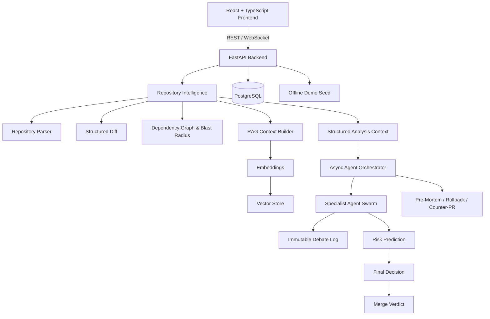

# CHRONOS — AI-Powered Pull Request Risk Intelligence

> **The AI engineer that writes tomorrow's incident report today.**

CHRONOS is an AI-native engineering platform designed to evaluate pull requests (PRs) before they are merged. It analyzes repository structure and code changes, combines engineering-domain findings with historical incident context, and produces risk assessments and actionable engineering artifacts such as pre-mortems, rollback plans, and counter-PR recommendations.

The project includes an **offline Demo Mode** with seeded repository data, sample pull requests, historical incidents, and a multi-agent analysis workflow. This allows users to explore the platform without connecting a live GitHub repository or configuring an external model API.

---

## Contents

- [Problem Statement](#-problem-statement)
- [Solution](#-solution)
- [Key Features](#-key-features)
- [How CHRONOS Works](#-how-chronos-works)
- [Multi-Agent System](#-multi-agent-system)
- [Technology Stack](#-technology-stack)
- [System Architecture](#-system-architecture)
- [Project Structure](#-project-structure)
- [Getting Started](#-getting-started)
- [Environment Configuration](#-environment-configuration)
- [Running Locally Without Docker](#-running-locally-without-docker)
- [API Documentation](#-api-documentation)
- [Demo Walkthrough](#-demo-walkthrough)
- [Security Notes](#-security-notes)
- [Current Scope and Extension Points](#-current-scope-and-extension-points)
- [Future Enhancements](#-future-enhancements)
- [Author](#-author)

## 🚨 Problem Statement

Traditional pull request reviews primarily focus on whether code changes appear correct at review time. However, a change that looks acceptable in isolation can introduce production risks through dependency interactions, security weaknesses, performance degradation, reliability issues, increased operational cost, or a larger-than-expected blast radius.

Engineering teams also need to understand how a proposed change could fail, what historical incidents may be relevant, and how to recover if deployment causes problems. These considerations are often spread across different tools, documents, and individual reviewers.

## 💡 Solution

CHRONOS brings these engineering checks into a single pull-request intelligence workflow.

It builds repository and change context, runs specialized analysis agents, grounds findings with relevant historical incident information, and combines the results into a risk assessment and merge recommendation. It can also prepare engineering artifacts to help teams anticipate failures and plan recovery before a change reaches production.

## ✨ Key Features

### 1. Pull Request Analysis
- Analyze pull-request changes and structured code diffs.
- Build repository context before agent evaluation.
- Examine dependency relationships and potential blast radius.
- Organize findings into structured analysis results.

### 2. Multi-Agent Engineering Review
Specialized agents evaluate different engineering dimensions, including:
- Security
- Reliability
- Performance
- Cost optimization
- Maintainability
- Risk prediction
- Final merge decision

Additional agents support pull-request analysis, incident simulation, pre-mortem generation, rollback planning, and counter-PR generation.

### 3. Risk Scoring and Merge Recommendation
- Combine domain-level risk signals.
- Consider repository blast radius and relevant historical incidents.
- Produce a composite risk score and confidence interval.
- Generate a merge verdict such as **Merge**, **Merge with Caution**, **Request Changes**, or **Block Merge**.
- Apply a critical-security override in the final decision logic.

### 4. Historical Incident Retrieval (RAG)
- Prepare text for retrieval using chunking and normalization.
- Generate deterministic local hash embeddings for the demo implementation.
- Retrieve similar historical context through a vector-store interface.
- Include relevant historical references in the analysis context.

### 5. Pre-Mortem and Incident Simulation
Generate a forward-looking view of how a proposed change could fail, helping engineers identify failure scenarios before deployment.

### 6. Rollback Planning
Prepare a rollback-oriented plan to help engineers understand recovery actions if a change causes an incident.

### 7. Counter-PR Support
Provide a counter-PR workflow for proposing corrective changes in response to identified risks.

### 8. Live Analysis and Debate View
The frontend includes agent-oriented visual components for presenting analysis progress, findings, and debate-log entries.

### 9. Offline Demo Mode
- Includes seeded repository, pull-request, and incident data.
- Supports a repeatable demonstration workflow.
- Does not require GitHub login, an external model API key, or a separately managed external database service when run using the supplied Docker Compose setup (the local PostgreSQL container is started by Compose).

---

## 🔄 How CHRONOS Works

The high-level workflow is:

1. **Select a Pull Request** — Choose a pull request from a connected repository or use one of the seeded demo examples.
2. **Build Repository Intelligence** — Parse repository information and code changes, construct structured diffs, and analyze dependency relationships and blast radius.
3. **Prepare Analysis Context** — Assemble the repository intelligence and relevant historical incident context into a structured analysis context.
4. **Run Specialist Agents** — Execute engineering-domain agents through the asynchronous orchestrator.
5. **Record Findings** — Store typed findings and evidence in the debate log so the reasoning trail can be inspected.
6. **Calculate Risk** — Aggregate domain signals, blast radius, and historical incident density into a composite risk score.
7. **Make a Merge Decision** — Apply the final decision rules and produce a merge recommendation.
8. **Generate Engineering Artifacts** — Present pre-mortem, rollback, and counter-PR outputs where supported by the workflow.
9. **Review Results** — Inspect risk, agent findings, historical grounding, and the final recommendation in the web interface.

## 🤖 Multi-Agent System

CHRONOS organizes analysis into specialized agent modules.

| Agent / Module | Responsibility |
|---|---|
| PR Analysis Agent | Supports pull-request analysis and change understanding. |
| Security Agent | Evaluates security-related risks. |
| Reliability Agent | Evaluates reliability concerns. |
| Performance Agent | Evaluates performance concerns. |
| Cost Agent | Evaluates cost-optimization concerns. |
| Maintainability Agent | Evaluates maintainability concerns. |
| Risk Prediction Agent | Calculates a composite risk score from domain findings, blast radius, and historical incident density. |
| Final Decision Agent | Produces the merge verdict using risk thresholds and critical-security override rules. |
| Incident Simulation Agent | Supports incident-scenario analysis. |
| Pre-Mortem Generator | Produces pre-mortem output. |
| Rollback Planner | Supports rollback planning. |
| Counter-PR Agent | Supports corrective pull-request recommendations. |

### Agent orchestration

The backend uses an asynchronous orchestrator and shared analysis context. Agents return structured results and findings rather than independently reading GitHub or database state. The debate log records findings with their category, severity, confidence, evidence, and historical references.

### Risk prediction

The current risk prediction implementation combines weighted domain signals with blast-radius classification and historical incident density. Its domain weights are:

| Domain | Weight |
|---|---:|
| Security | 30% |
| Reliability | 28% |
| Performance | 16% |
| Cost Optimization | 10% |
| Maintainability | 16% |

The implementation maps finding severity to numeric risk levels, then adds blast-radius and historical-incident contributions. The score is capped at 100 and includes a confidence interval.

The final decision agent can return:
- **Block Merge**
- **Request Changes**
- **Merge with Caution**
- **Merge**

A critical security finding triggers a block-merge override.

## 🧰 Technology Stack

| Layer | Technologies |
|---|---|
| Frontend | React 18, TypeScript, Vite |
| Styling and UI | Tailwind CSS, reusable shadcn-style components |
| Routing | React Router |
| Data fetching | TanStack Query, Axios |
| UI interactions | Framer Motion, Lucide React |
| Forms and validation | React Hook Form, Zod |
| Charts | Recharts |
| Backend | Python, FastAPI |
| API validation and settings | Pydantic Settings |
| ORM | SQLAlchemy 2 |
| Database | PostgreSQL 16 |
| Database migrations | Alembic |
| Retrieval / RAG | Embedding and vector-store interfaces, deterministic hash embeddings, in-memory vector store |
| Containerization | Docker, Docker Compose |
| Web server | Nginx (frontend container) |

## 🏛️ System Architecture



The repository intelligence pipeline prepares the analysis context consumed by the agents. The orchestrator coordinates agent execution, and normalized results are handled through application services. The architecture keeps provider-specific retrieval and agent implementation details behind explicit interfaces.

## 📁 Project Structure

```text
CHRONOS/
│
├── .env.example
├── docker-compose.yml
├── README.md
│
├── backend/
│   ├── agents/
│   │   ├── base_agent.py
│   │   ├── security_agent.py
│   │   ├── reliability_agent.py
│   │   ├── performance_agent.py
│   │   ├── cost_agent.py
│   │   ├── maintainability_agent.py
│   │   ├── risk_prediction_agent.py
│   │   ├── final_decision_agent.py
│   │   ├── incident_simulation_agent.py
│   │   ├── premortem_generator.py
│   │   ├── rollback_planner.py
│   │   └── counter_pr_agent.py
│   │
│   ├── analysis/
│   │   ├── blast_radius.py
│   │   ├── dependency_graph.py
│   │   ├── repository_parser.py
│   │   └── structured_diff.py
│   │
│   ├── api/
│   │   └── routes/
│   ├── core/
│   ├── db/
│   ├── debate/
│   ├── demo/
│   ├── demo_seed/
│   ├── git/
│   ├── github/
│   ├── incidents/
│   ├── models/
│   ├── orchestrator/
│   ├── prompts/
│   ├── rag/
│   ├── services/
│   ├── alembic/
│   ├── Dockerfile
│   ├── requirements.txt
│   └── main.py
│
├── frontend/
│   ├── src/
│   │   ├── components/
│   │   ├── context/
│   │   ├── hooks/
│   │   ├── lib/
│   │   ├── pages/
│   │   ├── services/
│   │   ├── types/
│   │   └── main.tsx
│   ├── Dockerfile
│   ├── package.json
│   └── vite.config.ts
│
├── docs/
│   ├── architecture.md
│   ├── development.md
│   ├── deployment.md
│   └── judge-demo.md
│
└── demo-seed/
```

## 🚀 Getting Started

### Prerequisites

For the Docker-based setup:
- Git
- Docker
- Docker Compose

For manual development:
- Python 3.12 recommended
- Node.js 22 recommended
- npm
- PostgreSQL 16

### 1. Clone the repository

```bash
git clone <YOUR_GITHUB_REPOSITORY_URL>
cd CHRONOS
```

Replace `<YOUR_GITHUB_REPOSITORY_URL>` with the URL of your GitHub repository.

### 2. Configure environment variables

Copy the example environment file:

**Windows PowerShell**
```powershell
Copy-Item .env.example .env
```

**macOS / Linux**
```bash
cp .env.example .env
```

For the default local demo, the example values are intended to support the Docker Compose setup. Replace development secrets before using the application in any shared or production environment.

### 3. Start the application with Docker Compose

```bash
docker compose up --build
```

Docker Compose starts:
- PostgreSQL database
- FastAPI backend
- React frontend served through Nginx

The backend container applies database migrations and seeds the demo data during startup.

### 4. Open the application

| Service | URL |
|---|---|
| Frontend | http://localhost:5173 |
| Backend health check | http://localhost:8000/health |
| API documentation | http://localhost:8000/docs |

The API documentation is enabled outside production mode.

### 5. Stop the application

```bash
docker compose down
```

To also remove the PostgreSQL data volume:

```bash
docker compose down -v
```

**Warning:** `docker compose down -v` deletes the database volume and its persisted data.

## ⚙️ Environment Configuration

The project provides `.env.example` with the following settings:

| Variable | Purpose |
|---|---|
| `ENVIRONMENT` | Application environment, such as development or production. |
| `DEBUG` | Enables or disables debug mode. |
| `DATABASE_URL` | PostgreSQL connection URL. |
| `SECRET_KEY` | Application secret; replace the example value. |
| `CORS_ORIGINS` | Allowed frontend origins. |
| `GITHUB_CLIENT_ID` | GitHub OAuth application client ID. |
| `GITHUB_CLIENT_SECRET` | GitHub OAuth application client secret. |
| `GITHUB_CALLBACK_URL` | OAuth callback URL. |
| `ENABLE_DEMO_AUTH` | Enables the development demo-authentication flow. |
| `LOG_LEVEL` | Application logging level. |

GitHub OAuth values in the example file are blank placeholders. Configure them with your own GitHub OAuth application credentials when using live GitHub integration.

## 💻 Running Locally Without Docker

### Backend

From the repository root:

1. Create and activate a Python virtual environment.
2. Install backend dependencies.
3. Configure a running PostgreSQL database and set `DATABASE_URL` in `.env`.
4. Apply migrations and seed the demo data.
5. Start the API server.

```bash
python -m venv .venv
```

**Windows PowerShell**
```powershell
.venv\Scripts\Activate.ps1
```

**macOS / Linux**
```bash
source .venv/bin/activate
```

Install dependencies:

```bash
pip install -r backend/requirements.txt
```

Run migrations, seed demo data, and launch the backend:

```bash
alembic -c backend/alembic.ini upgrade head
python -m backend.demo_seed.seed
uvicorn backend.main:app --reload --port 8000
```

### Frontend

Open a separate terminal:

```bash
cd frontend
npm install
npm run dev
```

The Vite development server runs on the configured local development port and proxies `/api` requests to the backend on port 8000.

For additional setup details, see [`docs/development.md`](docs/development.md).

## 📖 API Documentation

When the backend is running in development mode, FastAPI provides interactive API documentation at:

```text
http://localhost:8000/docs
```

A health-check endpoint is available at:

```text
GET http://localhost:8000/health
```

It returns the service health status.

## 🎬 Demo Walkthrough

CHRONOS includes a deterministic offline demo flow.

1. Open `http://localhost:5173`.
2. Select **Try demo mode**.
3. Choose **Refactor payment queue and retry policy** (the critical-risk example described in the demo guide).
4. Start the agent swarm.
5. Review the agent findings, historical grounding, DebateLog, risk score, and merge verdict.
6. Inspect the generated pre-mortem and rollback runbook.
7. Open Settings and reset the demo to demonstrate that the workflow can be repeated.

For the complete walkthrough, see [`docs/judge-demo.md`](docs/judge-demo.md).

## 🔐 Security Notes

- Replace the development `SECRET_KEY` with a strong, unique secret before deployment.
- Do not commit real `.env` files, OAuth secrets, tokens, or credentials.
- Configure restrictive `CORS_ORIGINS` for the deployed frontend.
- GitHub OAuth credentials must be configured before enabling live OAuth integration.
- Disable development demo authentication in production by setting `ENABLE_DEMO_AUTH=false`.
- Use a managed and secured PostgreSQL instance for production deployments.
- The API documentation is disabled when the application runs in production mode.

## 🧪 Current Scope and Extension Points

The supplied codebase includes a modular backend with repository analysis, agent orchestration, a debate log, risk scoring, API routes, database models and migrations, and a frontend for presenting engineering analysis.

Some components are intentionally designed as extension points:
- The RAG package defines embedding and vector-store abstractions. The included hash embedding provider and in-memory vector store provide a deterministic local implementation suitable for demo and tests.
- Agent implementations follow a shared base-agent contract and return structured findings.
- The architecture separates repository intelligence, orchestration, API handling, and persistence so that providers and specialist agents can be extended independently.
- GitHub OAuth configuration is supplied through environment variables and must be configured for live account integration.

The offline demo is the recommended way to explore the project without external credentials.

## 🔮 Future Enhancements

Potential directions for extending CHRONOS include:

- Integrate production-grade semantic embedding and persistent vector database providers.
- Expand repository-language and framework coverage.
- Add richer dependency and service-topology analysis.
- Connect additional historical incident sources and engineering knowledge bases.
- Introduce configurable organization-specific risk policies.
- Improve explainability with deeper evidence-to-verdict traceability.
- Add integrations with CI/CD pipelines and code-hosting platforms.
- Support team-level dashboards, notifications, and audit workflows.
- Add automated evaluation datasets for measuring agent quality and risk-calibration accuracy.

## 👩‍💻 Author

**Keerthana Raja**  
B.E. Computer Science and Engineering  
Chennai Institute of Technology

GitHub: [keerthanaraja7972007](https://github.com/keerthanaraja7972007)

---

<p align="center">
  <b>CHRONOS — Think about production failures before they happen.</b>
</p>

