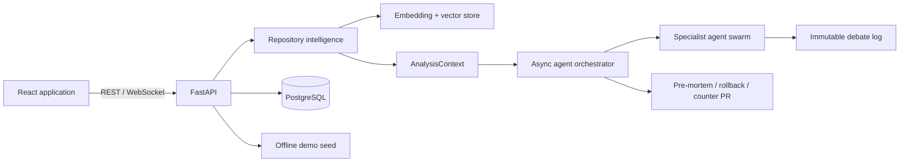

# CHRONOS architecture

The intelligence pipeline produces the sole input to agents. Agents never read GitHub or database state directly; they return typed findings through the orchestrator and DebateLog.
